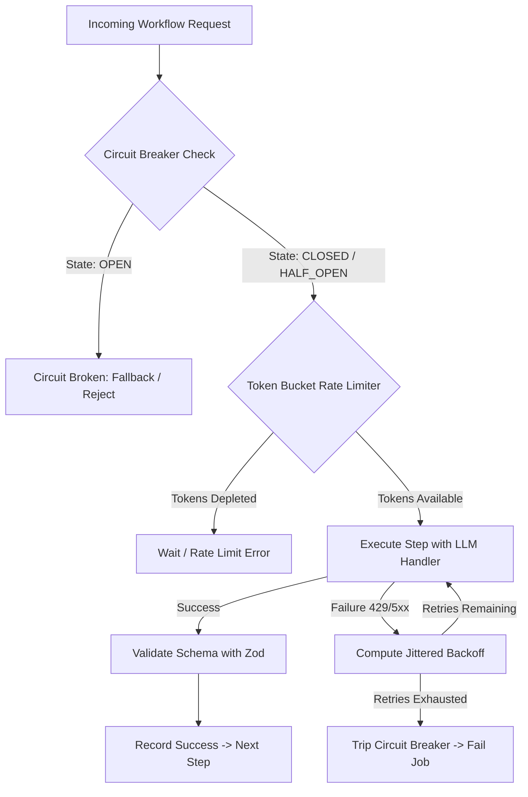

<div align="center">

# 🤖 AI Automation Bot

**Enterprise-Grade Resilient LLM Workflow Orchestrator & Task Pipeline**

[](https://github.com/flegartech-mvp/ai-automation-bot/actions)
[](https://www.typescriptlang.org/)
[](https://opensource.org/licenses/MIT)
[](https://vitest.dev/)
[](https://github.com/flegartech-mvp/ai-automation-bot)

[**Live Demo**](https://agent.flegartech.com) • [**API Documentation**](https://docs.agent.flegartech.com) • [**Report Bug**](https://github.com/flegartech-mvp/ai-automation-bot/issues)

</div>

---

## 📌 Executive Summary

**AI Automation Bot** is a production-hardened LLM orchestration engine designed to execute multi-step autonomous AI workflows without brittle outages. Engineered with distributed systems resilience patterns—including **exponential backoff with full jitter**, **token-bucket rate limiting**, and **circuit breaker fail-safes**—it safeguards applications against upstream LLM rate limits, network flakes, and cascading API collapses.

---

## 🎯 Target Persona & Real-World Use Cases

- **Autonomous Agent Builders:** Chain multi-model prompts with guaranteed structured output validation via Zod schemas.
- **Enterprise SaaS Engineers:** Prevent cascading failures and thundering herd conditions during peak traffic or OpenAI/Anthropic/Gemini provider degradations.
- **Data Mining & Synthesis Pipelines:** Orchestrate long-running extraction, reasoning, code generation, and verification jobs with stateful retry semantics.

---

## 🚀 Live Demo & Interactive Preview

| Workflow Pipeline Visualizer | Circuit Breaker Telemetry |
| :---: | :---: |
| [](https://agent.flegartech.com) | [▶ Launch Orchestrator Sandbox](https://agent.flegartech.com/playground) |

---

## ⚡ Key Engineering Highlights

- **Circuit Breaker State Machine (`CLOSED` ⇄ `OPEN` ⇄ `HALF_OPEN`):** Automatically halts traffic to failing LLM backends to prevent resource starvation and bill spikes.
- **Jittered Exponential Backoff:** Distributes retries uniformly across time windows to eliminate synchronized thundering herds.
- **Token Bucket Rate Limiting:** Enforces strict client-side RPM/TPM compliance before dispatching network requests.
- **Strict Output Schema Verification:** Ensures every LLM step satisfies rigid TypeScript/Zod schemas before passing context to downstream steps.

---

## 🏗️ System Architecture & Data Pipeline



---

## 🛠️ Quickstart & Local Development

### Prerequisites
- Node.js `20.x` or higher
- `pnpm` `9.x` (recommended) or `npm`

### Installation & Execution

```bash
# 1. Clone the repository
git clone https://github.com/flegartech-mvp/ai-automation-bot.git
cd ai-automation-bot

# 2. Install dependencies
pnpm install

# 3. Configure environment variables
cp .env.example .env

# 4. Start local development server
pnpm dev

# 5. Run automated test suite
pnpm test

# 6. Typecheck & linting verification
pnpm typecheck
```

---

## 🧪 Testing & Quality Assurance

```bash
pnpm test:coverage
```

Our Vitest test suite comprehensively covers:
- Backoff randomization bounds and distribution
- Rate-limiter capacity enforcement and refill intervals
- Circuit breaker state transitions under simulated error injection
- Transient failure recoveries vs. fatal exception propagation

---

## 📄 License & Contributing

Distributed under the **MIT License**. Contributions and provider adapters (Ollama, vLLM, Bedrock) are welcome!
