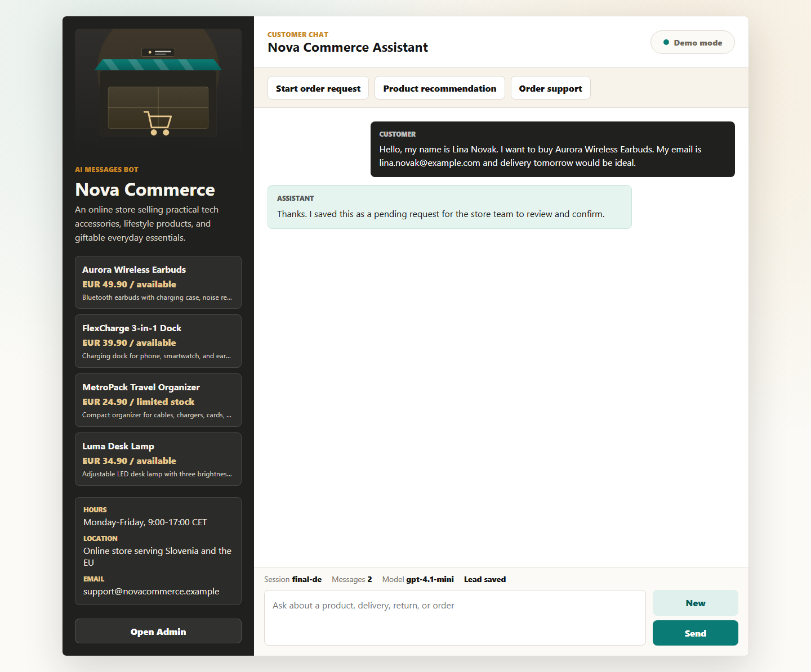

<div align="center">
  
  <h1>AI E-commerce Automation Bot</h1>
  <p>A secure, configurable customer-support chatbot with lead capture and an owner dashboard.</p>
  <p><strong>A Tini Flegar portfolio project</strong> · <a href="https://github.com/flegardev">GitHub</a></p>
</div>



## What it does

- answers catalog, policy, delivery, return, and order questions
- uses OpenAI when configured and a deterministic local-demo reply mode otherwise
- collects customer requests without inventing prices, stock, discounts, or order status
- persists conversations and leads to a mounted local data directory
- gives an authenticated owner dashboard for lead review and status updates
- ships with responsive browser smoke tests, security regression tests, and a production Docker image

## Quick start

Requirements: Node.js 22+ and npm.

```bash
npm ci
```

Copy `.env.example` to `.env`, set a strong `ADMIN_TOKEN`, then start the app:

```bash
npm run dev
```

- Chat: `http://localhost:3000`
- Admin: `http://localhost:3000/admin`

The admin API is disabled when `ADMIN_TOKEN` is missing. The dashboard asks for
the token and sends it only as `Authorization: Bearer ...`; URL tokens are
rejected.

## Configuration

Edit `config/business.json` to change the business name, catalog, prices,
opening hours, contact details, policies, FAQs, and assistant tone. The server
builds its system prompt from that file for every request.

| Variable               | Required                                      | Purpose                                                                       |
| ---------------------- | --------------------------------------------- | ----------------------------------------------------------------------------- |
| `ADMIN_TOKEN`          | Yes for admin access; mandatory in production | Protects customer PII under `/api/admin/*`; use at least 16 random characters |
| `OPENAI_API_KEY`       | No                                            | Enables live OpenAI replies; blank uses local-demo mode                       |
| `OPENAI_MODEL`         | No                                            | Model name; defaults to `gpt-4.1-mini`                                        |
| `OPENAI_TIMEOUT_MS`    | No                                            | OpenAI request timeout; defaults to 20 seconds                                |
| `DATA_DIR`             | Production                                    | Directory for durable JSON files; mount persistent storage                    |
| `ALLOWED_ORIGINS`      | No                                            | Comma-separated cross-origin allowlist; blank is same-origin only             |
| `TRUST_PROXY`          | Behind a proxy only                           | Explicit number of trusted proxy hops used to derive the rate-limit IP        |
| `RATE_LIMIT_WINDOW_MS` | No                                            | Fixed rate-limit window; defaults to 60 seconds                               |
| `RATE_LIMIT_MAX`       | No                                            | Requests per IP for `/api`; defaults to 60                                    |
| `CHAT_RATE_LIMIT_MAX`  | No                                            | Chat requests per IP per window; defaults to 20                               |

## Security model

The first valid chat request creates a server-owned UUID and a 256-bit random
conversation credential. The raw credential is returned once to that browser;
only its SHA-256 hash is persisted. History and later chat requests derive their
session exclusively from the bearer credential, so a caller-supplied session ID
cannot select another conversation.

The browser stores its conversation credential in local storage so a refresh
can restore that one thread. Starting a new chat discards it. Public chat APIs
return only a lead-captured boolean—customer contact fields are available only
through the separately authenticated admin API.

Additional controls include:

- bearer-only, timing-safe admin-token comparison
- Helmet security headers and a self-only Content Security Policy
- same-origin API access unless an explicit CORS allowlist is configured
- explicit proxy trust, per-IP rate limiting, and a tighter chat limit
- a 32 KB JSON-body ceiling and a bounded OpenAI request timeout
- `Cache-Control: no-store` on conversation and admin responses
- non-root Docker execution and a liveness health check

Treat the mounted data directory as sensitive: customer messages and lead data
are JSON files and are not encrypted by this application. When OpenAI mode is
enabled, recent conversation content is sent to the configured OpenAI model to
produce a response.

Existing pre-upgrade conversations have no scoped credential and therefore
cannot be restored in a public browser. They remain visible to an authenticated
administrator.

## API overview

| Route                        | Access                                                                                         |
| ---------------------------- | ---------------------------------------------------------------------------------------------- |
| `GET /health` or `/healthz`  | Public liveness probe                                                                          |
| `GET /api/health`            | Public app status; never returns secrets                                                       |
| `GET /api/config`            | Public storefront configuration                                                                |
| `POST /api/chat`             | First request is public; subsequent requests require the issued conversation bearer credential |
| `GET /api/messages`          | Conversation bearer credential required                                                        |
| `GET /api/admin/summary`     | Admin bearer token required                                                                    |
| `GET /api/admin/leads`       | Admin bearer token required                                                                    |
| `PATCH /api/admin/leads/:id` | Admin bearer token required                                                                    |

## Verification

| Command                               | Purpose                                                       |
| ------------------------------------- | ------------------------------------------------------------- |
| `npm run lint`                        | ESLint over server, browser code, and tests                   |
| `npm run format:check`                | Prettier verification                                         |
| `npm run test:security`               | Session isolation, PII, admin auth, and header regressions    |
| `npm test`                            | Playwright flows at desktop, laptop, tablet, and mobile sizes |
| `npm audit --audit-level=high`        | Dependency vulnerability gate                                 |
| `docker build -t ai-automation-bot .` | Production image build                                        |

See [DEPLOYMENT.md](DEPLOYMENT.md) for persistent-container deployment details.

## Deployment boundary

This application uses JSON-file persistence and an in-memory rate limiter. Run
one long-lived instance with a mounted disk. It is not suitable for serverless
functions or horizontal scaling without replacing both mechanisms with shared
services.

## License

No open-source license has been selected. The package is marked `UNLICENSED`
and is not intended for npm publication.
